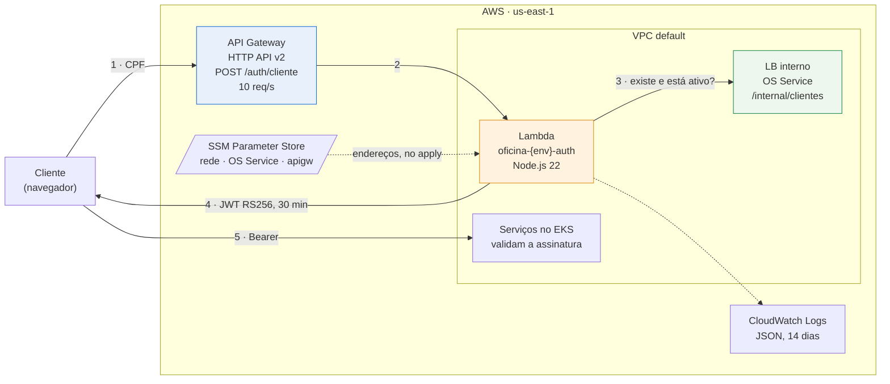

# oficina-auth-lambda

Function Serverless de **autenticação por CPF** da oficina. Nasceu na fase 3; na
**fase 4** deixou de ler o banco e passou a consultar o cliente no **OS Service**, dono dos
clientes — nenhum serviço acessa o banco de outro ([ADR 011](https://github.com/GustavoKikey/oficina-os-service/blob/main/docs/fase-4/adr/adr-011-lambda-consulta-os-service.md)).

> Checklist da entrega da fase 4 (requisito → onde está): [README do OS Service](https://github.com/GustavoKikey/oficina-os-service#entrega-da-fase-4--onde-está-cada-requisito).

## O que faz

Recebe um CPF, decide se aquele cliente pode entrar, e devolve um JWT que as APIs
protegidas aceitam:

1. **valida o CPF** (formato + dígitos verificadores);
2. **consulta existência e status** do cliente no OS Service
   (`GET /internal/clientes`, pelo load balancer interno, com `X-Internal-Token`);
3. **emite um JWT RS256** conforme o [ADR 001](https://github.com/GustavoKikey/tech-challenge-15SOAT/blob/main/docs/fase-3/adr/adr-001-contrato-jwt-cliente.md).

## Arquitetura



Três decisões que o desenho revela:

**A Function pergunta ao OS Service; os serviços não participam da autenticação.** O
cliente pertence ao OS Service, então a função consulta a rota interna dele em vez de ler
o banco. Os serviços só recebem o token pronto e conferem a assinatura com a chave pública.

**Sem saída para a internet.** O security group da função libera apenas a porta 80 dentro
da VPC — o load balancer interno do OS Service. URL, token interno e chave privada chegam
como variáveis de ambiente, injetadas no `terraform apply` — não são buscadas em runtime.

**Os endereços vêm do Parameter Store.** Nada de rede ou de URL está escrito neste
repositório: ele lê o que a plataforma (`oficina-infra-k8s`) e o OS Service publicaram.

## API

`POST /auth/cliente`

```json
{ "cpf": "529.982.247-25" }
```

| Status | Quando |
| --- | --- |
| `200` | Token emitido |
| `400` | CPF ausente, malformado ou com DV inválido |
| `401` | Cliente inexistente **ou** inativo |
| `500` | Falha interna (detalhe só no log) |

```json
{
  "accessToken": "eyJhbGciOiJSUzI1NiIs...",
  "expiresIn": 1800,
  "tokenType": "Bearer",
  "cliente": { "id": "70264968-...", "nome": "Alice" }
}
```

Cliente **inexistente** e **inativo** devolvem resposta idêntica de propósito:
distinguir os dois transformaria o endpoint num verificador de cadastro, permitindo
descobrir quais CPFs são clientes da oficina.

## Tecnologias

| | |
| --- | --- |
| Runtime | Node.js 22 (ESM) — o 20 saiu de suporte em abril de 2026 |
| JWT | `jsonwebtoken` (RS256) |
| Consulta do cliente | `fetch` nativo → OS Service |
| Testes | Vitest |

**Por que Node e não Java**, já que a aplicação é Quarkus: esta função está no
caminho crítico do login, onde cold start é sentido pelo usuário. Node parte em
~200 ms; uma JVM leva de 2 a 4 s. O código é pequeno (validar, consultar, assinar)
e não se beneficia do ecossistema Java aqui. O acoplamento que importa não é de
linguagem, é de **contrato** — e ele está fixado no ADR 001 e coberto por testes
dos dois lados.

## Estrutura

```
src/
  index.js         handler — orquestra e traduz para HTTP
  cpf.js           validação de CPF (espelha Documento.java)
  cliente-api.js   consulta ao OS Service (GET /internal/clientes, com timeout)
  token.js         emissão do JWT (contrato do ADR 001)
test/
  cpf.test.js      14 casos, incluindo equivalência com o algoritmo Java
  handler.test.js  contrato do token, 401 uniforme, base64, erro sem vazamento
  cliente-api.test.js  contrato com a rota interna: URL, token, 404, 403/5xx, timeout
```

## Rodar os testes

```bash
npm install
npm test
```

Node 22+. Não precisa do OS Service nem de AWS: a consulta é mockada.

## Variáveis de ambiente

Injetadas pelo Terraform **no momento do apply**, lendo SSM/Secrets Manager. A função
roda na VPC sem saída para a internet e por isso não consulta esses serviços em
runtime (ver [ADR 004](https://github.com/GustavoKikey/tech-challenge-15SOAT/blob/main/docs/fase-3/adr/adr-004-padrao-de-comunicacao.md), §3).

| Variável | Origem | Obrigatória |
| --- | --- | --- |
| `OS_URL_INTERNA` | SSM `/oficina/{env}/os/url-interna` (publicado pelo deploy do OS Service) | sim |
| `INTERNAL_TOKEN` | SSM `/oficina/{env}/os/token-interno` (SecureString) | sim |
| `OS_TIMEOUT_MS` | default `5000` | não |
| `JWT_PRIVATE_KEY` | Secrets Manager (chave gerada pelo Terraform do OS Service) — PEM cru ou base64 | sim |
| `JWT_ISSUER` | default `oficina-mvp` | não |
| `JWT_EXPIRACAO` | default `30m` (ADR 001) | não |

## Interoperabilidade com a aplicação

O token emitido aqui é validado pelos três serviços com a chave pública
correspondente. O contrato é o ADR 001; além dele, só a rota interna do ADR 011.

```
GET /cliente/ordens-servico  + token da Lambda   → 200, lista as OS do cliente
GET /cliente/ordens-servico  sem token           → 401
GET /cliente/ordens-servico  token adulterado    → 401
```

Para emitir um token fora do fluxo HTTP — útil ao depurar a validação do lado da
aplicação:

```bash
export JWT_PRIVATE_KEY=$(cat caminho/para/privateKey.pem)
node --input-type=module -e "
import { emitirToken } from './src/token.js';
console.log(emitirToken({ id: '<uuid-do-cliente>', nome: 'Teste' }, '<cpf>').accessToken);
"
```

## Infraestrutura

`infra/` provisiona a função e o API Gateway. **Último da cadeia** — consome a rede da
plataforma e, do OS Service, a URL do LB interno, o token e a chave do JWT, via SSM e
Secrets Manager. O ambiente inteiro sobe com `scripts/aplicar.sh hom` no oficina-infra-k8s.

| Recurso | Configuração |
| --- | --- |
| Lambda | Node.js 22, 512 MB, timeout 15s, **dentro da VPC** |
| API Gateway | HTTP API (v2), rota `POST /auth/cliente` |
| Throttling | 10 req/s, rajada de 20 — protege contra força bruta de CPF |
| Logs | CloudWatch, 14 dias, formato JSON com `requestId` |

512 MB não é por consumo de memória: na Lambda a CPU é proporcional à memória, e a
assinatura RS256 é sensível a isso.

**Validado na AWS em 2026-11-16**, pelo API Gateway: CPF inválido → `400`; CPF válido sem
cadastro → `401` (a função consultou o OS Service pelo load balancer interno, que respondeu
404); cliente cadastrada → token emitido e aceito pela área do cliente do OS Service.

```bash
cd infra

terraform init \
  -backend-config="bucket=oficina-tfstate-SEU-SUFIXO" \
  -backend-config="dynamodb_table=oficina-tflock-SEU-SUFIXO"

terraform apply -var="ambiente=hom"
```

## CI/CD

`.github/workflows/ci-cd.yml`

| Gatilho | O que faz |
| --- | --- |
| Pull Request | Testes (Vitest) + `fmt`/`validate` do Terraform |
| push na `main` | Testes → `apply` em `hom` → **smoke test** |
| *Run workflow* | Testes → `apply` em `hom` ou `prod` (promoção manual) → smoke test |

Com a sessão do Learner Lab fechada, ou com o OS Service ainda não implantado (sem
`/oficina/{env}/os/url-interna`), o deploy é pulado com aviso em vez de falhar.

O smoke test envia um CPF inválido e exige `400` — resposta que só a função consegue
dar. Gateway ou Lambda quebrados devolveriam 500/502 e falhariam o job.

Secrets: `AWS_ACCESS_KEY_ID`, `AWS_SECRET_ACCESS_KEY`, `AWS_SESSION_TOKEN`,
`TF_STATE_BUCKET`, `TF_LOCK_TABLE` (renovados por `scripts/renovar-secrets.sh` do
oficina-infra-k8s). A chave do JWT não passa mais pelo GitHub: o Terraform a lê do
Secrets Manager.

